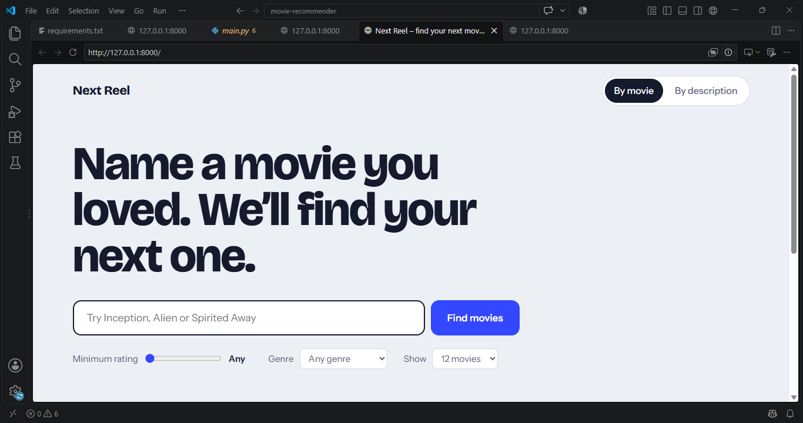
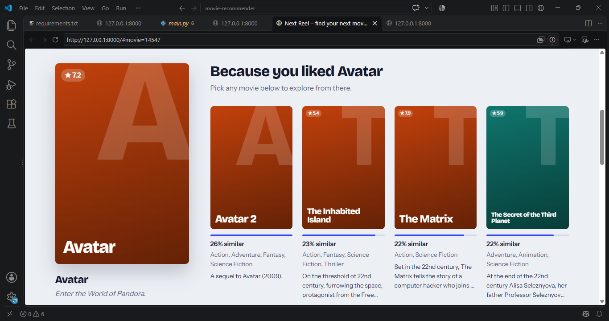

# Next Reel – Movie Recommendation System

A content-based movie recommender built with **FastAPI**, **scikit-learn (TF-IDF + cosine similarity)** and a responsive **HTML/CSS/JavaScript** frontend.

Pick a movie you loved and get similar films, or describe what you want to watch ("a heist crew in space with a reluctant hero") and get matches.

## Screenshots





## Features

- **Search by movie** with keyboard-friendly autocomplete
- **Search by description** using free text matched against 45,000+ movies
- **Filters** for minimum rating, genre and number of results
- **Explore trail**: click any recommendation to continue from it, then jump back along your path
- Generated typographic posters, responsive on desktop and mobile

## How it works

1. Each movie's text (overview, tagline, genres) is cleaned and turned into a TF-IDF vector (50,000 terms, single words and two-word phrases).
2. For a chosen movie, cosine similarity against every other vector gives a ranked list of the closest matches.
3. For a text description, the same TF-IDF vectorizer converts the query into a vector, which is compared the same way.
4. FastAPI exposes this as a JSON API, and the static frontend calls it.

## Tech stack

Python, FastAPI, Uvicorn, pandas, NumPy, SciPy, scikit-learn, HTML, CSS, JavaScript

## Run it locally

```bash
git clone https://github.com/<your-username>/<repo-name>.git
cd <repo-name>
pip install -r requirements.txt
python -m uvicorn main:app --reload
```

Open http://127.0.0.1:8000 (interactive API docs at `/docs`).

The model files must be in the `data/` folder: `df.pkl`, `tfidf.pkl`, `tfidf_matrix.pkl`.

> Pickle files can run code when loaded. Only load pickles from sources you trust.

## API

| Endpoint | Description |
| --- | --- |
| `GET /api/search?q=` | Title autocomplete |
| `GET /api/recommend/{id}?n=&min_rating=&genre=` | Movies similar to a given movie |
| `GET /api/describe?q=&n=&min_rating=&genre=` | Movies matching a text description |
| `GET /api/popular` | Popular movies to start from |
| `GET /api/genres` | List of genres |
| `GET /api/movie/{id}` | Details for one movie |

## Project structure

```
├── main.py            # FastAPI app and recommendation logic
├── requirements.txt
├── data/              # df.pkl, tfidf.pkl, tfidf_matrix.pkl
└── static/            # index.html, style.css, app.js
```

## Notes

- Movies are looked up by row id, because some titles appear more than once.
- `scikit-learn` is pinned to 1.6.1 to match the version that created the saved vectorizer.

## Future ideas

- Hybrid ranking that blends similarity with rating
- A minimum-similarity cutoff to hide weak matches
- Real poster images from a movie API
- Deployment (Render, Railway or Docker)

## Data

Movie metadata from <add your dataset name and link here>.

## Notebook

The model was built in Google Colab: data cleaning, TF-IDF vectorization, cosine similarity, and exporting the pickle files used by the API.

[](https://colab.research.google.com/github/Mfarhanimran/movie-recommender-fastapi/blob/main/notebooks/recommendation_system.ipynb)
